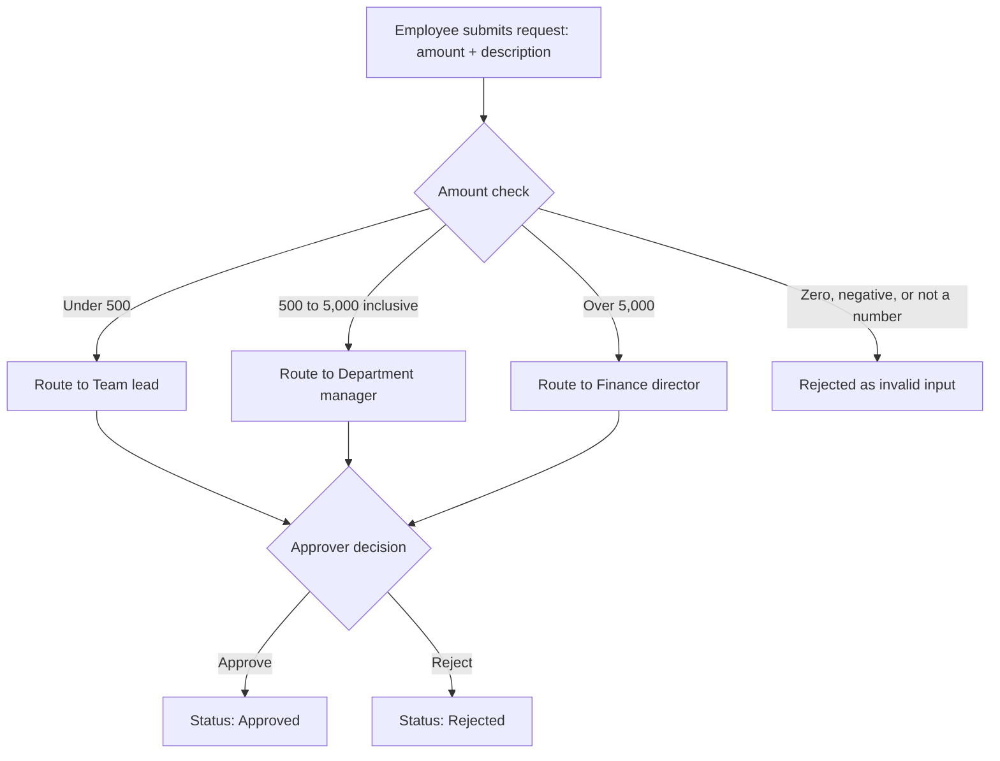

# Purchase Request Approval Workflow

A Python prototype that routes purchase requests to the right approver based on the request amount, tracks their status, and persists them to a data file.

## What it does
- Employees create a purchase request with an amount and description
- The system applies threshold rules to decide who must approve it
- Approvers approve or reject, and the status is tracked

## Approval rules
| Purchase amount | Approver required  |
|-----------------|--------------------|
| Under 500       | Team lead          |
| 500 to 5,000    | Department manager |
| Over 5,000      | Finance director   |

The 5,000 boundary is inclusive: a request of exactly 5,000 goes to the Department manager.
Amounts that are zero, negative, or not a number are rejected as invalid.

See [docs/approval-thresholds.md](docs/approval-thresholds.md) for details and [docs/user-stories.md](docs/user-stories.md) for requirements.

## Process flow



## Getting started

Requirements: Python 3 and pip.

```
git clone https://github.com/ambello01/purchase-approval-workflow.git
cd purchase-approval-workflow
python -m venv .venv
.venv\Scripts\activate        # Windows
# source .venv/bin/activate   # macOS / Linux
pip install pytest
```

## Usage

Run commands from the project root:

```
python -m src.cli create --requester "Alice" --amount 1200 --description "Laptop dock"
python -m src.cli submit 1
python -m src.cli show 1
python -m src.cli approve 1        # or: reject 1
python -m src.cli list
python -m src.cli list --status approved
```

| Command   | What it does                                          |
|-----------|-------------------------------------------------------|
| `create`  | Create a draft request (`--requester`, `--amount`, `--description`) |
| `submit`  | Submit a draft; the required approver is assigned     |
| `approve` | Approve a submitted request                           |
| `reject`  | Reject a submitted request                            |
| `show`    | Show one request by ID                                |
| `list`    | List all requests, optionally filtered with `--status` | draft, submitted, approved, or rejected

Requests are stored in a SQLite database (requests.db), created in the directory you run the CLI from. Use --file <path> to choose a different location. The schema is in schema.sql. Invalid actions (for example approving a draft) print an error and exit with code 1.

## Run the tests

```
python -m pytest
```

## Project structure

```
purchase-approval-workflow/
├── docs/
│   ├── approval-thresholds.md
│   └── user-stories.md
├── src/
│   ├── approval_rules.py      # threshold routing
│   ├── request_workflow.py    # request model and status transitions
│   ├── storage.py             # persistence
│   └── cli.py                 # command-line interface
├── tests/
│   ├── test_approval_rules.py
│   ├── test_cli.py
│   ├── test_request_workflow.py
│   └── test_storage.py
├── schema.sql
├── pytest.ini
└── README.md
```

## Built with AI

This project reflects how I work: I gather and formalize business needs, then work with developers (and, here, an AI assistant) to turn them into tested, working software.

I built this project with an AI assistant as a step-by-step guide. Here is an honest breakdown of who did what.

**What I asked the AI to do**
- Help me start the project and guide me through it step by step.
- Suggest a language and tooling. It suggested Python, and I went with it.
- Help write the code and tests as we went, which I then ran and verified myself.

**What I decided myself**
- The status flow: how a request moves from created, to submitted, to approved or rejected.
- The approval limits: who can approve which amounts.
- The exact boundary rules. I pushed to remove ambiguity on the amounts (for example, what happens at exactly the threshold value), so the rules are explicit rather than assumed.

**What I corrected or rejected**
- **Storage: JSON to SQLite.** The first version stored requests in `requests.json`. I moved the project to SQLite (`requests.db`) so the data layer behaves more like a real system. This also meant updating `.gitignore` so local database files don't get committed.
- **Test failures.** Some tests failed after the storage change. I debugged them until the threshold rules passed in tests, not just in manual runs.
- **Clean-clone check.** I cloned the repo fresh into a new folder, followed the README from scratch, and ran the tests to confirm the instructions work on a clean machine.

## Author
Modibbo AHMADOU BELLO